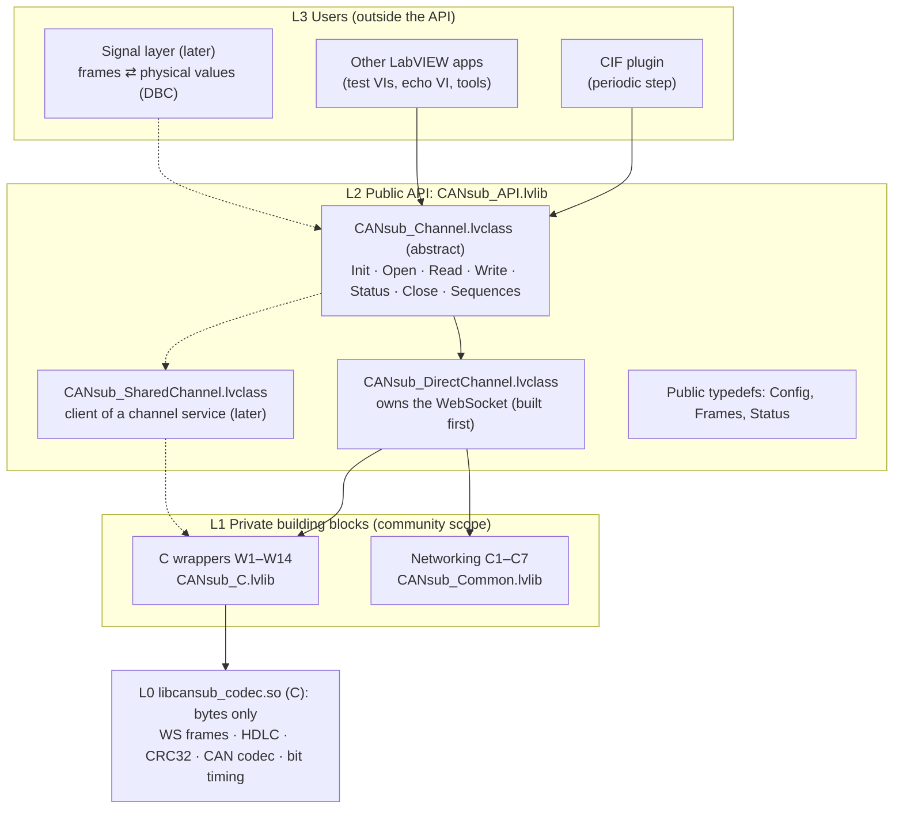

# CANsub LabVIEW API: architecture

**Status:** design, 2026-10-23; section 5 updated 2026-11-09. The L1 parts (wrappers, C1–C7)
are built and tested (S1–S6); the L2 API is built in ticket 3 (`API_BUILD.md`). It defines how plugins
(CIF plugins and other LabVIEW applications) use the CANsub. The wrapper VIs of
`c_functions\LABVIEW_C_TEST.md` and the shared VIs of `..\common\COMMON_BUILD.md` become
**private** parts of this API.

Decisions this design follows (2026-10-23):

| Question | Decision |
|---|---|
| Who calls it | CIF plugins **and** other LabVIEW applications. The API must not depend on CIF. |
| Can several plugins share one channel? | **Not decided.** The API hides it: a plugin cannot see whether it owns the channel or shares it. "Direct" ownership is built first. |
| API style | **LVOOP class, by value.** The object lives in the caller's shift register; there are no locks. |
| How a periodic step gets frames | **Both modes, chosen at Open:** poll in the step, or a reader loop + RT FIFO. The same Read method works in both. |

---

## 1. Layers



| Layer | Contains | Who may call it |
|---|---|---|
| **L0** | `libcansub_codec.so`: all byte work. No I/O, no allocation. | only L1 wrappers (CLFN) |
| **L1** | **C wrappers** W1–W14: one CLFN each. **Networking** C1–C7: REST, TLS + Nagle off, WebSocket handshake and close. | only L2 (access scope **Community**, friend = `CANsub_API.lvlib`) |
| **L2** | **`CANsub_Channel.lvclass`** and its children, plus three public typedefs | every plugin and application |
| **L3** | CIF plugins, test VIs, the echo VI, tools; later a signal (DBC) layer | – |

**Rule:** a plugin calls **only** L2. It never calls a wrapper, a REST VI or a TCP function for
the CANsub. All device knowledge (ports, JSON, filters, timing, framing, ping/pong, the device
traps) is inside L2. Then a device or firmware change touches one library, not every plugin.

---

## 2. The public API (L2)

### 2.1 Public typedefs

| Typedef | Content |
|---|---|
| `CANsub_Config.ctl` | `connection` (`common\Typedefs\CANsub_connection.ctl`: `host` string, `channel` U8 1–4, `cert path` path), `bit rates` (`common\Typedefs\CANsub_Bit_Rates.ctl`: `nominal bit rate` U32, `nominal sample point` DBL %, `data bit rate` U32, `data sample point` DBL %) — both typedefs added 2026-11-06 and first used in S4; the C1–C7 connectors stay scalar, `listen only` (Bool), `filters` (array of {`extended`, `range`, `f1`, `f2`}; empty = accept all), `read mode` (enum `Poll`, `Reader`), `max bytes per read` (I32, `4096`), `reader FIFO depth` (frames), `reader priority` (for the reader loop), `ownership` (enum `Direct`, `Shared`; only `Direct` exists at first) |
| `CANsub_Frames.ctl` | the frame buffer, **owned by the caller**: `count` (I32), and parallel arrays `t_dev` (DBL), `id` (U32), `flags` (U16), `dlc` (U8), `data_len` (U8), `data` (U8, 64 bytes per frame). The same layout as the C decoder, so Read fills it in place. Capacity is set once by `Frames_Create` |
| `CANsub_Status.ctl` | `state` (enum `Closed`, `Open`, `Lost`), counters (`frames read`, `frames written`, `crc errors`, `decode errors`, `FIFO overflows`, `reopens`), `nodelay` (I32), `api version` (string), `lib version` (U32), `bit timing` (`Bit_Timing.ctl`), `last error` |

For one frame, the `flags` bits are those of the C library: IDE 0001, FDF 0002, RTR 0004, BRS
0008, ESI 0010, TX ack 0020, error frame 0040. The accessors `Frame_Get` and `Frame_Flags`
(section 2.2) save plugins from bit masks.

### 2.2 Methods

**Loop-safe** = no memory allocation, no blocking longer than the stated timeout, bounded
execution time. Call only loop-safe methods in a periodic step or a time-critical loop.
**Setup/teardown only** = the method allocates or may block (REST, TLS, close handshake): call it
before or after the loop (CIF Prepare / Stop), never in it. *(Renamed 2026-11-10 from "RT-safe",
because every method runs on the RT target; the term is about the loop, not the target.)*
VI descriptions end with `Loop-safe: no allocation, bounded time.` or `Setup/teardown only: do
not call in a periodic loop (allocates, may block).`

| Method | What it does | When | Loop-safe |
|---|---|---|---|
| `Init` (static) | Checks the config, computes the bit timing (W9), makes the object. **No I/O.** | configure / Prepare | no (allocates) |
| `Open` | `ownership` = Direct → `CANsub_DirectChannel`:<br/>1. REST setup: version check, channel must be `stopped`, delete filters and sequences, phy (C2 `before_ws`);<br/>2. TLS + Nagle off (C4);<br/>3. WebSocket handshake (C6);<br/>4. filters (C2 `after_ws`, from `filters`);<br/>5. allocate every buffer once (W12) + `csb_warmup`;<br/>6. `read mode` = Reader → start the reader loop.<br/>Checks `csb_version` ≥ the required version. | Prepare / Start | no |
| `Frames_Create` (static) | Makes a `CANsub_Frames` buffer with a fixed capacity. One per caller, kept in its shift register. | Prepare | no (allocates once) |
| **`Read`** | Gives every frame that arrived since the last call. It **never waits longer than `timeout ms`** (0 = no wait). Answers pings by itself. Mode **Poll**: TCP Read (Immediate) + W13, in the caller's thread. Mode **Reader**: drains the RT FIFO. Fills `CANsub_Frames` in place and sets `count`. On connection loss: `state` = `Lost` and an error, no exception. | every step | **yes** |
| `Frame_Get` (static) | Frame `i` of a `CANsub_Frames` → `id`, `ide`, `fdf`, `brs`, `rtr`, `tx_ack`, `error`, `t_dev`, `data_len`, plus `data` byte access by index (no array copy) | in the step | **yes** |
| **`Write`** | Sends frames: either `n` frames from a `CANsub_Frames` buffer (with a list of indexes and new IDs, e.g. an echo), or one frame (`id`, flags, data). Encodes into the object's pre-allocated TX buffer; **one TCP Write per call**. | every step | **yes** (the TCP Write string, see 4.3) |
| `Status` | `CANsub_Status`, by value | any time | yes |
| `Sequence_Create` / `_Start` / `_Delete` | Device transmit sequences (cyclic rest-bus traffic, done by the device, ±3 µs), through REST. **Sequences stop when the WebSocket closes:** after a `Reopen`, the API creates them again by itself from its list. | Prepare / Start | no |
| `Reopen` | After `state` = `Lost`: Close, then Open with the same config, then the sequences again. The device discards pending frames and disables the controller on connection loss, so this is the only way back. | when `Read` reports `Lost` (not in a time-critical loop) | no |
| `Close` | Stops the reader loop, WebSocket close (C7), frees the buffers. Runs also with an error in. | Stop | no |

**Why a by-value object works here:** each object is used by one loop at a time, the one that
owns it. No other loop changes it, so there is no lock and no copy, as long as the object goes
straight from shift register to method and back. In Reader mode, the reader loop has its **own**
data (the connection and its decode buffers), handed over at Open. The object in the caller
holds only the FIFO reference and the TX side (see 3.2).

### 2.3 Error codes

| Range | Source |
|---|---|
| 5000 | REST call failed (status ≠ expected), from C2 |
| 5003, 5004, 5005 | C4: TCP_NODELAY not set; C6: WebSocket handshake failed; C4/X5: TCP keepalive not set (A7) |
| 5001, 5002 | bit timing: invalid input, no one-prescaler solution |
| 5101–5104 | C library return values (−1 … −4) |
| **5200–5299** | **API**: 5201 channel busy (another client owns it), 5202 not open, 5203 connection lost (text: "`<operation>`: the connection is lost (cause: error `<code>`, `<source>`)", made by `Lost_Error`), 5204 library version too old, 5205 FIFO overflow (Reader mode), 5206 frames buffer too small, 5207 invalid config (or a feature not built yet), 5208 method not implemented by this class (parent `CANsub_Channel` bodies), 5209 frame index out of range (`Frame_Get`) |
| 5300–5399 | **CIF class `CAN RW CANsub`**: 5301 Interface string not valid (`<host>/<channel>`, channel 1 to 4), 5302 `Write`: not all pcap bytes were converted (incomplete packet, or more frames than the buffer holds) |

---

## 3. The two read modes

### 3.1 Poll mode (build first)

```
caller's loop (one thread)
  Read:  TCP Read (Immediate, max 4096 B, timeout = `timeout ms`) ─► W13 decode in place ─► Frames
  Write: W14 / batch encode ─► TCP Write
```
- Simple: one thread, no hand-over.
- Latency: a frame waits up to one step period, plus the device's 0.5 ms flush tick.
- Use when the step period is short compared with the latency you need, or when the plugin
  only monitors.

### 3.2 Reader mode

```
reader loop (started by Open; reentrant VI via Start Asynchronous Call; priority from config)
  TCP Read (Immediate, timeout 100 ms) ─► W13 decode ─► one RT FIFO write per frame record
caller's loop
  Read:  drain the RT FIFO (up to Frames capacity) ─► Frames
  Write: encode ─► TCP Write on the same connection
```
- The TCP connection is read in one loop and written in the other (full duplex), **if test V1
  (section 9) passes**. An OpenSSL `SSL` object must not be used by two threads at the same time,
  so LabVIEW either serializes TCP Read and TCP Write on one TLS connection internally, or the
  parallel use is unsafe. V1 measures which. If V1 shows serialization, TX goes through a queue
  to the reader loop, which then does all the TCP I/O. That loop becomes an "I/O loop"; the
  caller's `Write` only enqueues.
- **Hand-over from the reader loop to `Read`** (an L2-private decision; plugins do not see it).
  **RT FIFOs do not take clusters** (confirmed 2026-10-23). Two candidates:

  | Option | How | For | Against |
  |---|---|---|---|
  | **A. RT FIFO, U8[80] element** | one 80-byte record per frame (`t_dev` 8, `id` 4, `flags` 2, `dlc` 1, `data_len` 1, `data` 64). RT FIFOs take fixed-size arrays of numerics. C helpers pack and unpack the records. | standard LabVIEW RT tool; easy to inspect | one FIFO write per frame (~2500/s at full load); pack/unpack per frame |
  | **B. Lock-free SPSC ring in the C library** | `Open` allocates the ring once in C and gets back a handle (U64). The reader loop's decode writes straight into the ring; `Read` copies the frames out into `Frames`. C11 atomics; one writer, one reader. | no LabVIEW allocation, no packing, one call per read | C-owned memory: `Close` must free it, and a stale handle can crash `lvrt` (the handle is checked with a magic number) |

  **Default: B**, because it keeps all per-frame work in C. A is the fallback if C-owned memory
  is not wanted. iceoryx and CIPC are **not** needed here: they are for passing frames *between*
  plugins or processes (section 7, decision 1), not within one channel object.
- **Overflow:** if the step does not drain fast enough, the FIFO is full: the reader counts
  `FIFO overflows` and drops the newest frame. It never blocks, because a blocked reader stops the
  ping answers and the device then closes the connection.
- Use when the latency must not depend on the step period, or the step period is long.

**Same Read for both:** a plugin does not know the mode. It calls `Read` and gets `Frames`.

---

## 4. Rules for real-time use

1. **All allocation happens in Init / Open / Frames_Create.** In the loop, only `Read`,
   `Frame_Get`, `Write` and `Status`.
2. The object and the `Frames` buffer go from shift register → method → shift register with **no
   branch**. A branch (to an indicator, a probe or a second method in parallel) makes LabVIEW copy
   the whole object on every iteration.
3. **Remaining allocations:** LabVIEW's TCP Read returns a new string, and TCP Write takes a
   string. Both are bounded (≤ 4096 B and ≤ 174 B per frame) and inside LabVIEW's TCP functions.
   **[verify]** whether LabVIEW 2025's TCP Write accepts a U8 array; that would remove one of them.
4. **No method waits longer than its timeout.** `Read` with `timeout ms` = 0 never waits.
5. **Never put** Open, Close, Reopen or the sequence methods in a time-critical loop: they do
   REST calls and allocate.
6. **Priority:** the calling loop decides its own priority. The API's Reader loop takes its
   priority from the config. Keep the TCP work out of *Time-critical* priority (NI: no TCP/IP at
   time-critical priority).
7. **Execution settings:** the API VIs are preallocated reentrant, Normal priority, same as caller,
   with debugging off in the built library. This is the same rule as the native build doc.
8. **One `CANsub_Channel` object per channel.** Two objects for the same channel (Direct
   ownership) → the second `Open` fails with 5201: the device allows one client per channel.

---

## 5. How applications and plugins use it

*Updated 2026-11-09 (after S6, before the API build), to show where each built component ends
up. Method names follow `API_BUILD.md` (ticket 3: `Write_Frame`, `Write_Echo`).*

### 5.1 What a caller sees, and what is hidden

A caller sees **only** the `CANsub_Channel` object, its 9 methods and the three typedefs
(`Config`, `Frames`, `Status`). Everything built in S1–S5 is either the inside of those methods
or bench tooling:

| Component | What it is | Used later by |
|---|---|---|
| C library + generated CLFN VIs (S1, S2a) | the byte work | the wrappers only |
| W9, W12, W14, W15, `C_Send_Pong`, `C_Decode_To_Frames` (new, API step A2) | the RT wrappers | the API methods `Open`, `Read`, `Write_*` only |
| W1–W8, W10, W11 | test and setup wrappers | the P tests only |
| C1–C7, X1–X4 (S3) | the connection steps: REST, TLS + Nagle, handshake, close | `Open` and `Close` only |
| `Test_*` VIs | proofs that each part works | nobody in production |
| `Echo_*`, `CANsub_Echo_C` (S5) | the benchmark application for the harness | the bench; also the first example of an application |

So the many components are the **inside of 9 methods**, built and proven one at a time.

### 5.2 A plain LabVIEW application

**Without the API** (S5 today), the application wires the internals itself: W9 → C2 → C4 → C6 →
C2 → W12, then TCP Read → pending → W13 → pong, then C7. It has 6 shift registers and must know
the device traps.

**With the API:**

```
Config (connection, bit rates)
   │
 Init ──► Frames_Create (capacity, e.g. 1756) ──► Open
   │                                                │
   └───────────────── While Loop ───────────────────┘
        │  channel ──► Read (timeout 100 ms) ──► channel      2 shift registers:
        │  frames  ──►                       ──► frames       channel, frames
        │                     │
        │        For i = 0 … frames.count − 1
        │           Frame_Get (frames, i) → id, flags, t_dev, data …
        │           application logic
        │           Write_Frame (channel, id, flags, data)
        │             or Write_Echo (channel, frames, i, new id)
        │
        └─ stop on: Stop, an error, or Status.state = Lost
   │
 Close
```

The application never sees REST, TLS, WebSocket, HDLC, ping/pong, filters or buffers. A receive
monitor is only `Init`, `Frames_Create`, `Open`, loop {`Read` → `Frame_Get` → indicators},
`Close` (API step A4: `Test_API_Receive`). The S5 echo becomes `CANsub_Echo_API` (step A5): its
loop body is `Read` → for each frame `Echo_Classify` → `Write_Echo` or the UDP report.

### 5.3 A CIF plugin (adapter pattern)

The plugin uses the same calls. It keeps the `CANsub_Channel` object and its `CANsub_Frames`
buffer in its own state (shift register / plugin data) and knows nothing about the device.
**[verify]** The exact phase names and how a plugin keeps its state come from the CIF plugin
template, which is not reviewed yet; the API does not depend on them.

| CIF phase | API calls |
|---|---|
| Configure / Prepare | config from the plugin settings (`Config_FromJSON`, planned) → `Init` → `Frames_Create` → `Open` |
| Start | `Sequence_Create` / `_Start` for cyclic rest-bus frames, if any (after ticket 3) |
| Step (periodic) | `Read` (timeout 0, never waits) → frames → CIF; frames from CIF → `Write_Frame`. `Status` counters → diagnostic tags. If `state` = `Lost`: set a fault tag; recover in a non-time-critical part (`Reopen`, after ticket 3). |
| Pause | nothing (the device keeps the channel; sequences keep running) **[decide]**: or stop the sequences |
| Stop | `Close` |

**Two ways to connect the frames to CIF** (decided in the CIF ticket):

| Option | How | For | Against |
|---|---|---|---|
| **A. Raw CAN interface in NI's CIF CAN format (pcap / SocketCAN)** — recommended | W16 `Frames` → pcap packets to CIF; W17 pcap from CIF → frames → `Write_Frame` | NI's CIF CAN tools (frames, signals, database) work with the CANsub like with any other CAN interface; the plugin stays small. Library 1.2.0's pcap functions are already checked against NI's `Build Socket CAN.vi` / `Parse Next Socket CAN.vi`. | needs W16/W17 + test P6-CIF |
| B. Signal plugin | the plugin decodes signals (DBC) and publishes CIF tags | no pcap step | the plugin holds the tag mapping and the signal decode (until a signal layer exists) |

### 5.4 Why the API comes before the CIF adapter

Without the API, every application and the CIF plugin repeats the S5 wiring and every device
trap (filters, channel must be `stopped`, ping/pong, leftover bytes, close). With the API that
wiring exists once, inside `Open`, `Read`, `Write_*` and `Close`, and the A/B runs of
`API_BUILD.md` prove that it costs nothing.

---

## 6. Packaging and versions

| Item | Packaging |
|---|---|
**Decided 2026-11-12: no packed library for the API.** Applications and the CIF plugin
use the **source libraries** directly (`CANsub_API.lvlib`, `CANsub_C.lvlib`,
`CANsub_Common.lvlib`, `CANsub_Codec.lvlib`), from the repo. The rows below replace the earlier
`CANsub_API.lvlibp` plan.

| Item | Packaging |
|---|---|
| `CANsub_API.lvlib` and its dependencies | Source libraries from the repo, added to each project that uses them (C client project, the CIF plugin project). Access scopes stay **Public** (tests and applications may call the L1 VIs; the rule "plugins call only L2" is a code-review rule, not enforced by scope). |
| CIF plugin | Its own project; it adds the source libraries. If CIF requires the plugin itself to be built as a packed library, the API is compiled **into** that plugin build (each plugin then has its own copy: fine, because one channel has one owner). **[verify]** in the CIF ticket with the plugin template. |
| Caution | A library can be open in only one project at a time: close `CANsub_C_Client.lvproj` before opening the CIF project. |
| `libcansub_codec.so` | Deployed to `/usr/local/lib/` on each target. `Open` checks `csb_version()` ≥ the version the API needs (error 5204). |
| `cansub_root_cert.crt` | `/home/lvuser/cansub_root_cert.crt` (path in the config) |
| Versioning | By git commit of the repo (no separate API build number). The API states the minimum C library version it needs. |

**Planned additions to the C library (version 1.2)**, needed by the API:
- `csb_encode_frames_to_ws(...)`: encode `n` frames (from arrays, with new IDs) into **one** buffer
  for one TCP Write. This is the batch `Write`.
- For Reader mode, option B: `csb_ring_create` / `_destroy` (the only `malloc`/`free`, called by
  `Open`/`Close`), `csb_decode_ws_to_ring`, `csb_ring_read` (into the `Frames` arrays). With
  option A instead: `csb_records_pack` / `_unpack` for U8[80] RT FIFO elements.

---

## 7. Open decisions (do not block the first build)

| # | Question | Default until decided |
|---|---|---|
| 1 | Shared channel service (several plugins on one channel)? **The transport between plugins is decided together with this:** **CIPC channels** if every consumer is a CIF plugin (it ties only the shared child to CIF); **iceoryx** (zero-copy shared memory, needs its library and the RouDi daemon on the target) if non-CIF apps or other processes (Python, C++) also consume the frames. | Direct only. Shared = a later child class `CANsub_SharedChannel`: a service owns the WebSocket, and clients get frames by ID filter. No plugin changes. |
| 2 | TCP Read and Write on one TLS connection from two loops | test **V1** (section 9) before Reader mode |
| 3 | Reader-loop hand-over (RT FIFOs take no clusters) | option **B**, the C ring (section 3.2); A = RT FIFO U8[80] as fallback |
| 4 | CIF Pause: keep or stop sequences | keep |
| 5 | Where the signal (DBC) layer lives: API, separate library, or plugin | separate library above L2, using the db tooling's tables |
| 6 | Automatic Reopen inside Read (Reader mode) or always by the caller | by the caller |

---

## 8. Build order

1. Finish the **L1 tests** first: P0 (library on the target), P1–P3, P3-RT. The API builds on
   wrappers that are proven to work.
2. **L2, Direct + Poll:** the typedefs, `Init`, `Open`, `Frames_Create`, `Read`, `Frame_Get`,
   `Write` (single frame first), `Status`, `Close`.
3. **Redo S4 and S5 as API users.** The echo VI is the reference test: its harness numbers must
   match those measured with direct wrapper calls. This proves the API adds no copies.
4. C library 1.2: batch encode → batch `Write`.
5. Sequences and `Reopen`.
6. **Reader mode**, after the two [verify] items.
7. A CIF adapter for one real plugin.
8. ~~Package `CANsub_API.lvlibp`~~ — not done (2026-11-12): callers use the source libraries (section 6).

---

## 9. Test V1: TCP Read and TCP Write on one TLS connection, from two loops

**Question:** can one loop sit in **TCP Read** on the TLS connection while another loop calls
**TCP Write** on the same connection, and do both calls really run at the same time?

**Why it is not obvious:** LabVIEW's TLS uses OpenSSL, and an OpenSSL connection object must not
be used by two threads at once. So LabVIEW must either serialize the two calls (then a write
waits until the read returns), or it runs them in parallel unprotected (then data can be
corrupted). The test separates the three cases: **parallel**, **serialized** and **broken**.

**Setup (no harness needed):**
- CH1: a Python receiver that ACKs and counts the frames (the bus needs a second active node):
  ```
  python -c "import can,os,time; b=can.Bus(interface='cansub',channel=os.environ['CANSUB_HOST']+'@1',bitrate=500000,max_device_time_skew=None); n=0; t=time.time()
  while time.time()-t<700:
      m=b.recv(1)
      if m is not None and not m.is_error_frame: n+=1
  print('CH1 received',n); b.shutdown()"
  ```
- CH2: the test VI `Test_V1_Duplex.vi`, with the TX acknowledgements on (they are in the phy
  body), so that every frame it writes comes back as a TX ack through the same connection. This
  gives the read side real traffic.

**`Test_V1_Duplex.vi`** (group T):
1. Before the loops: C2 `before_ws` → C4 TLS connect → C6 handshake → C2 `after_ws`. Then W12
   buffers for the reader.
2. **Loop R (reader)**, Normal priority: **TCP Read** Immediate, `4096`, timeout **100 ms** →
   W13 decode → count the frames with `tx_ack` = True, and check each ack's data: a running
   counter in bytes 0–3. Record **`read errors`** (error codes other than 56). Stop on the Stop
   flag (a local variable is acceptable in this test only).
3. **Loop W (writer)**, the same priority, in parallel: every **1 ms** (Wait Until Next ms
   Multiple), W10 (`id` `0x7FF`, 8 bytes: counter in bytes 0–3) → TCP Write. Measure **each TCP
   Write call** with High Resolution Relative Seconds before and after it; store the durations
   in a pre-allocated DBL array (600 000 elements = 10 min). Record **`write errors`**.
4. Run **10 minutes**: 600 000 frames. Then Stop, C7 close.
5. **Phase 2 (the critical case):** run 5 minutes more with the write period at **20 ms**. Then
   loop R waits inside TCP Read with nothing to read most of the time. That is exactly the
   situation in which a serializing lock would make each write wait for the read timeout.
   **Keep the CH1 receiver running.** Without an ACK on the bus, the device retransmits, its 64 kB
   TX buffer fills, and TCP Write blocks from **device back-pressure**. That would look like a
   LabVIEW lock and give a false "serialized" result.

**Results to report:** TCP Write duration median / p99 / max, phase 1 and phase 2 separately;
`write errors`; `read errors`; TX acks counted; ack data errors; CH1 count.

| Result | Meaning | Consequence for Reader mode |
|---|---|---|
| Write p99 ≪ 1 ms in **both** phases; acks = frames written; 0 data errors; 0 errors | **parallel and safe** | full duplex: the reader loop reads, the caller's `Write` writes |
| Phase 2 write durations near the read timeout (~100 ms, or the rest of it), phase 1 short | **serialized** by LabVIEW | TX must move into the reader loop (I/O loop + TX queue), or use a short read timeout (costs CPU) |
| Errors such as 1, 42, 56 on writes, corrupted acks, CRC errors, or a crash | **not thread-safe** | never use one TLS connection from two loops; one I/O loop does both |

Report the numbers; Reader mode is designed only after V1. Poll mode does not depend on V1:
there, one loop does both read and write.
