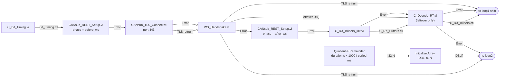
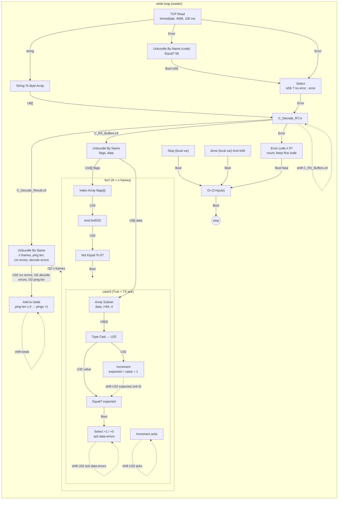
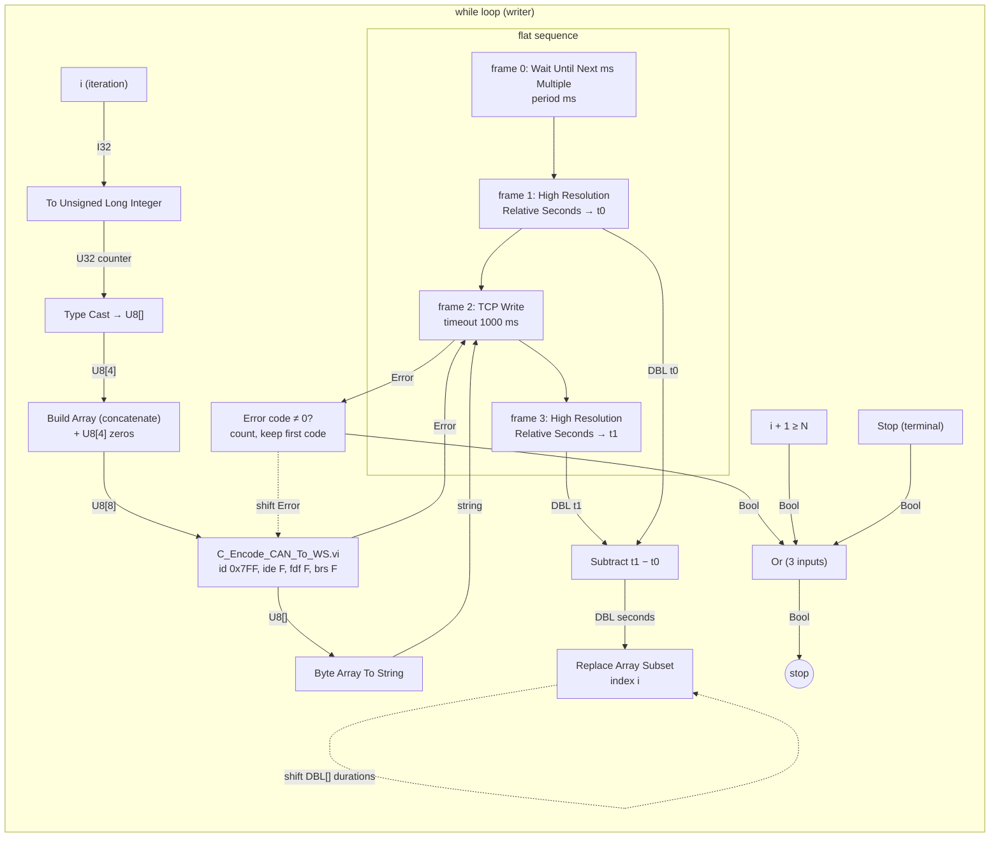
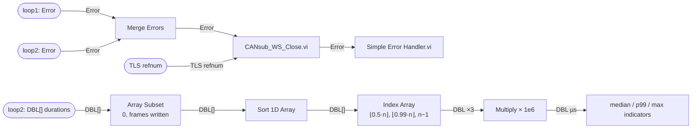

# `Test_V1_Duplex.vi`: proposed block diagram

Status: **PROPOSED** (not built). Source: `ARCHITECTURE.md` section 9. Drawn in the lvkit netlist
style, so it can be compared with `render` after the VI is built.

Conventions: one box per node. SubVIs by file name, primitives by LabVIEW name. Structures are
subgraphs (`loop1`, `for2`, `case3`, `seq4`). Edge labels are data types. `shift` = shift
register. The error wire is drawn on every chain.

**Settings:** group **T**: Non-reentrant, Normal priority, Inline No, Standard execution system,
automatic error handling off. **Run it on the PXIe target**, not on Windows: the question is
about LabVIEW TLS on NI Linux RT.

**One design choice (mine, not in section 9):** phase 1 and phase 2 are **two runs** of the same
VI, with different controls. This keeps the VI simple and gives separate numbers per phase.

| Run | `period ms` | `duration s` | Frames `N` |
|---|---|---|---|
| Phase 1 | `1` | `600` | 600 000 |
| Phase 2 | `20` | `300` | 15 000 |

Keep the CH1 Python receiver running for **both** runs (section 9 setup; set its time limit to
cover both runs plus the gap).

---

## 1. Before the loops

- Order matters: `after_ws` (the two filter POSTs) runs **after** the handshake. Without the
  filters the device sends nothing, also no TX acks.
- `C_Decode_RT` on `leftover` keeps the HDLC state in step. It finds no acks (nothing is written
  yet).
- `C_Bit_Timing` inputs: 500 kbit/s, 2 Mbit/s, 80 % (the bench defaults).
- The TLS refnum branches to both loops. That branch is the subject of the test.

## 2. `loop1`: reader (While Loop)

Rules for this loop:
- **Error 56** (read timeout) is normal. Clear it and continue.
- Any other error: `read errors` + 1, keep the first code in `first read error`, **stop**. A
  broken connection makes more reads useless.
- **Stop** when: the Stop button, or a fatal error, or (`done` = True **and** this read timed out).
  The last condition drains the acks that arrive after the last write.
- **Pings:** count them, **do not** send a pong. A pong is a second writer, and that would change
  the test. **[verify]** If `pings seen` > 0 and the run ends with error 66, the device needs a
  pong; then we add it.
- `expected` starts at `0`. Each ack must hold `expected` in bytes 0–3, else `ack data errors` + 1.
  Then `expected` = value + 1, so one bad ack counts once and not for every later ack.

## 3. `loop2`: writer (While Loop)

Rules for this loop:
- The **flat sequence** forces the order wait → `t0` → TCP Write → `t1`. Without it, LabVIEW can
  run High Resolution Relative Seconds at any time, because it has no error terminals.
- Only the TCP Write call is inside `t0`…`t1`. Encoding is outside the measurement.
- `durations` is pre-allocated (section 1). **Replace Array Subset** writes in place. No
  allocation in the loop except W10 and the TCP Write string (both small, accepted for a test).
- Any write error: `write errors` + 1, keep `first write error`, **stop**.
- `frames written` = `i` + 1 at exit. After the loop: write `done` = True (the reader reads it
  with a local variable; local variables are acceptable in this test only).

## 4. After the loops

C7 runs also when there is an error (it clears `error in` itself). Its error output is merged, so
the first error stays visible.

## Connector pane / front panel

Top-level test VI: these are front-panel terminals. Connector pane is optional.

| Inputs | Outputs |
|---|---|
| `host` (string, no default) | `frames written` (I32) |
| `cert path` (path) | `write median µs`, `write p99 µs`, `write max µs` (DBL) |
| `channel` (U8, `2`) | `write errors` (U32), `first write error` (I32) |
| `period ms` (U32, `1`) | `read errors` (U32), `first read error` (I32) |
| `duration s` (U32, `600`) | `acks counted` (U32), `ack data errors` (U32) |
| `read timeout ms` (I32, `100`) | `crc errors` (U32), `decode errors` (I32), `pings seen` (U32) |
| `Stop` (Bool) | `durations` (DBL[]), `done` (Bool), `error out` |

## Expected values (phase 1, parallel case)

| Value | Expected |
|---|---|
| `frames written` | `600000` |
| `acks counted` | = `frames written` |
| `ack data errors`, `crc errors`, `decode errors` | `0` |
| `write errors`, `read errors` | `0` |
| `write p99 µs` | ≪ 1000 |
| CH1 count | = `frames written` |

Interpretation: the table in `ARCHITECTURE.md` section 9. The key comparison is **phase 2
`write p99`**: near 100 000 µs (the read timeout) means **serialized**.

## After you build it

I run `index` (refresh), `unresolved`, then `render` on the VI, and compare with this design.
Known blind spots for lvkit: TCP Open Connection, TCP Get Raw Net Object (inside C4), and CLFNs
(untested).
